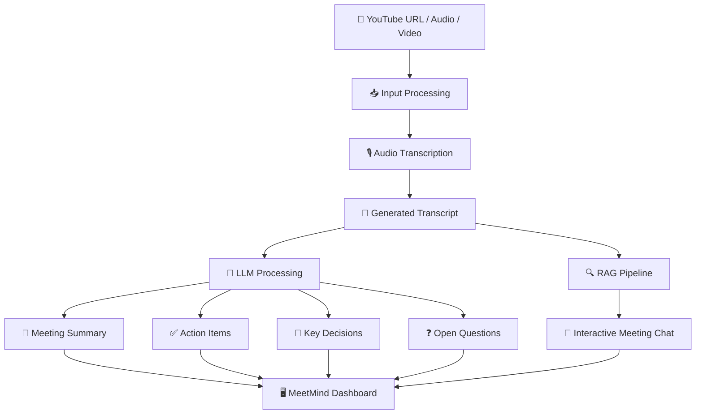

# 🧠 MeetMind AI
### Intelligent Video & Meeting Assistant

<p align="center">
  <b>Turn conversations into intelligence. Turn meetings into action.</b>
</p>

<p align="center">
  An AI-powered meeting intelligence platform that transforms YouTube videos and audio/video recordings into structured knowledge, actionable insights, and interactive conversations.
</p>

<p align="center">
  
  
  
  
  
</p>

---

## 🚀 Overview

**MeetMind AI** is an intelligent video and meeting assistant designed to eliminate the effort of manually reviewing lengthy meetings, lectures, and video recordings.

Powered by Generative AI, LangChain, speech transcription, and Retrieval-Augmented Generation (RAG), MeetMind converts unstructured conversations into meaningful, searchable, and actionable information.

Instead of spending hours revisiting recordings, simply upload a file or provide a YouTube URL and let MeetMind do the heavy lifting.

**One recording. Multiple insights. One intelligent assistant.**

---

## ✨ Core Features

| Feature | Description |
|---|---|
| 🎙️ Smart Transcription | Converts audio/video recordings into text. |
| 🌐 YouTube Integration | Processes YouTube video URLs. |
| 📝 AI Summarization | Generates concise and meaningful meeting summaries. |
| ✅ Action Item Extraction | Identifies tasks, responsibilities, and follow-ups. |
| 🔑 Key Decision Detection | Extracts important decisions made during discussions. |
| ❓ Open Question Extraction | Identifies unanswered questions and unresolved topics. |
| 💬 AI Meeting Chat | Interact with your meeting using natural language. |
| 🔍 RAG-based Retrieval | Retrieves relevant meeting context to answer user queries. |
| 🌍 Language Support | Supports English and Hinglish transcription options. |
| 🖥️ Interactive Dashboard | Clean, modern Streamlit interface for meeting insights. |

---

## 🧬 How MeetMind Works

MeetMind follows an AI-powered processing pipeline that transforms raw media into structured intelligence.



### Processing Pipeline

**01 — Input Processing**

Users provide a YouTube URL or upload an audio/video file.

**02 — Audio Processing**

The media processing module prepares the input for transcription and divides it into manageable chunks where required.

**03 — Speech-to-Text**

The transcription pipeline converts spoken conversations into readable text, supporting English and Hinglish options.

**04 — Intelligent Extraction**

The LLM analyzes the transcript to generate:
- Meeting title
- Structured summary
- Action items
- Key decisions
- Open questions

**05 — Retrieval-Augmented Generation**

The transcript is passed into the RAG pipeline to enable contextual question answering.

**06 — Interactive Experience**

Users can explore meeting insights and chat with their recordings through the Streamlit dashboard.

---

## 🛠️ Tech Stack

| Category | Technologies |
|---|---|
| Programming Language | Python |
| Frontend / UI | Streamlit |
| LLM Orchestration | LangChain, LangChain Expression Language (LCEL) |
| Generative AI | Mistral / Gemini / Other configured LLM providers |
| Speech Recognition | Configured transcription services |
| RAG | Retrieval-Augmented Generation |
| Media Processing | Audio / Video Processing, FFmpeg |
| Environment Management | Python Virtual Environment, python-dotenv |
| Version Control | Git, GitHub |

---

## 📂 Project Structure

```text
MeetMind-AI/
│
├── app.py                     # Streamlit application
├── main.py                    # CLI application entry point
├── requirements.txt           # Python dependencies
├── .env.example               # Environment variable template
├── .gitignore                 # Ignored files and secrets
├── README.md
│
├── core/
│   ├── transcriber.py         # Audio transcription
│   ├── summarize.py           # AI title and summarization
│   ├── extractor.py           # Insights and information extraction
│   └── rag_engine.py          # RAG-based meeting chatbot
│
├── utils/
│   └── audio_processor.py     # Input and media processing
│
└── .streamlit/
    └── config.toml            # Optional Streamlit configuration
```

---

## ⚙️ Installation & Setup

Follow these steps to run MeetMind locally.

### 1. Clone the Repository

```bash
git clone https://github.com/saad-baig07/MeetMind-AI.git
```

### 2. Navigate to the Project

```bash
cd MeetMind-AI
```

### 3. Create a Virtual Environment

```bash
python -m venv .venv
```

Activate it:

**Windows**

```bash
.venv\Scripts\activate
```

**Linux / macOS**

```bash
source .venv/bin/activate
```

### 4. Install Dependencies

```bash
pip install -r requirements.txt
```

### 5. Configure Environment Variables

Create a `.env` file in the project root.

Add the API credentials required by your configured providers.

```env
MISTRAL_API_KEY=your_mistral_api_key
SARVAM_API_KEY=your_sarvam_api_key
GOOGLE_API_KEY=your_google_api_key
```

> **Security Notice:** Never upload your actual `.env` file or API credentials to GitHub. Use `.env.example` to document the required variables.

### 6. Launch MeetMind

Run the Streamlit application:

```bash
streamlit run app.py
```

Open your browser at:

```text
http://localhost:8501
```

---

## 💬 Interact With Your Meetings

MeetMind's RAG-based chatbot enables users to ask questions about their processed recordings.

Example queries:

- What are the main topics discussed?
- Summarize the important decisions.
- What tasks were assigned during the meeting?
- Which questions remain unanswered?
- Explain the discussion about a particular topic.
- What were the major challenges discussed?

Instead of searching through lengthy transcripts manually, users can retrieve relevant information through natural language queries.

---

## 🔐 Environment & Security

MeetMind uses environment variables to manage sensitive API credentials.

Security practices:

- API keys are stored in `.env`.
- `.env` is excluded through `.gitignore`.
- `.env.example` contains placeholder values.
- Deployment credentials are configured through Streamlit Secrets.
- Sensitive credentials should never be committed to version control.

---

## 🗺️ Future Roadmap

MeetMind is an evolving project. Planned enhancements include:

- [ ] Meeting history and persistent storage.
- [ ] Speaker identification and diarization.
- [ ] Timestamp-based transcript navigation.
- [ ] Export meeting reports as PDF.
- [ ] Downloadable meeting notes and action reports.
- [ ] Advanced semantic search across multiple meetings.
- [ ] Personalized AI-generated meeting insights.
- [ ] Real-time meeting transcription.
- [ ] Multi-meeting knowledge base.
- [ ] User authentication and personalized workspaces.

---

## 🎯 Project Vision

The goal of MeetMind is to make information from conversations more accessible, structured, and useful.

From online lectures and educational videos to professional meetings and team discussions, MeetMind aims to become an intelligent knowledge companion that helps people focus on conversations rather than documentation.

**Less time reviewing. More time understanding. More time executing.**

---

## 👨‍💻 Developer

**Saad Baig**

B.Tech – Computer Engineering

Silicon University

- GitHub: [@saad-baig07](https://github.com/saad-baig07)

---

<p align="center">
  <b>🧠 MeetMind AI</b>
  <br/>
  <i>Think Smarter. Meet Better. Execute Faster.</i>
  <br/><br/>
  Built with Python, Generative AI & LangChain.
</p>
